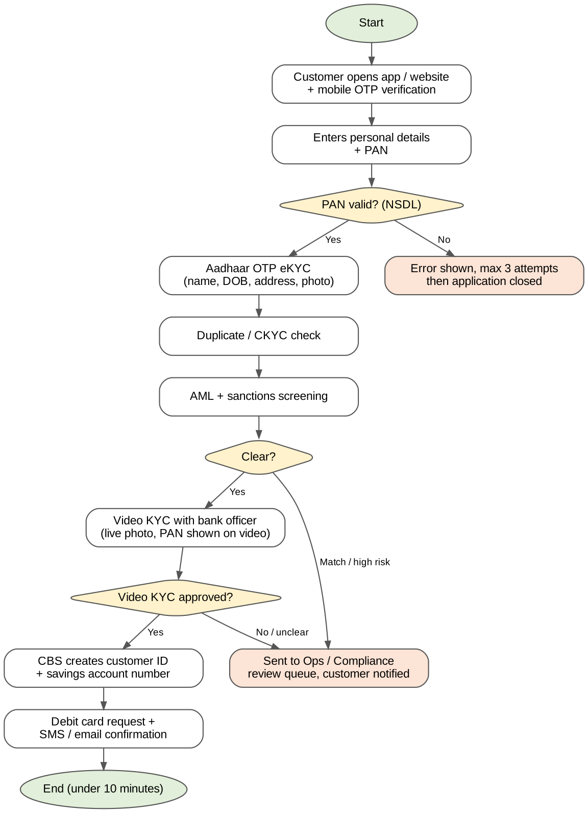
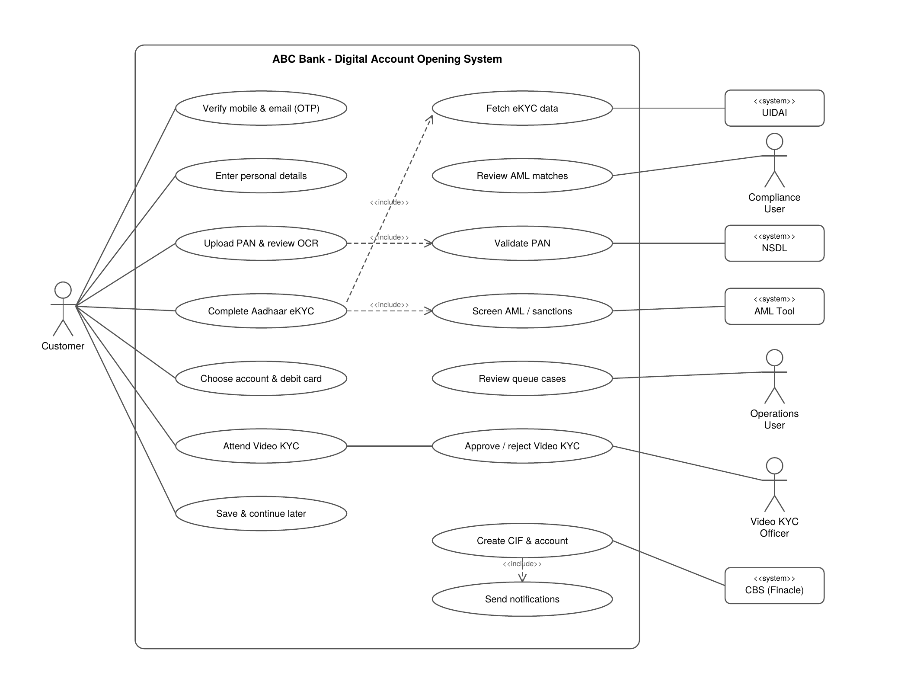

# Digital Savings Account Opening (Business Analysis Project)

A business analysis project on moving savings account opening at a bank from a branch-based, paper process to a fully digital one on the mobile app and website. Today the customer visits a branch, fills a paper form and waits 2 to 3 working days. The goal is an account opened in under 10 minutes, with KYC done online.

The bank (ABC Bank Ltd) is fictional, but the project follows how digital onboarding works in India: PAN check with NSDL, Aadhaar OTP eKYC, Video KYC (V-CIP) for full KYC, AML and sanctions screening, and account creation in the Core Banking System.

## What's in this repo

| File | What it is |
|---|---|
| `Digital_Account_Opening_BA_Project.pdf` | The full project in one document |
| `AsIs_Process_Flow.png` | As-Is flow (branch-based account opening) |
| `ToBe_Process_Flow.png` | To-Be flow (digital onboarding with KYC and AML checks) |
| `Use_Case_Diagram.png` | UML use case diagram |
| `Digital_Account_Opening_Wireframes.pdf` | 5 screens: OTP verification, PAN upload, Aadhaar eKYC, Video KYC, account opened |

## What I did

1. **Understanding the need** – how account opening works today, requirement gathering with 4 stakeholder groups, problem statement
2. **BRD** – objectives, scope, stakeholders, As-Is / To-Be, 13 business requirements (MoSCoW), 7 compliance requirements (RBI KYC, V-CIP, PMLA, CKYC, DPDP), assumptions, risks, KPIs
3. **FRD** – user roles, 30 functional requirements across 4 modules, business rules, error messages, NFRs, traceability matrix
4. **Process flow** – As-Is and To-Be flows
5. **Wireframes** – 5 low-fidelity screens with notes linked to the FRD
6. **Use case diagram** – actors, use cases and external systems (NSDL, UIDAI, AML tool, CBS)
7. **User stories** – 10 stories with acceptance criteria for a Jira backlog
8. **UAT test cases** – 14 test cases linked back to the requirements

## Process flow

## Use case diagram

## Tools

MS Word · Excel

## Key targets set in the BRD

- Account opening time: 2–3 working days → under 10 minutes
- Branch visits for new savings accounts down by 80%
- Completion rate up by 35%
- 85% of accounts opened with no manual step
- 0 accounts activated without KYC and AML checks

---
*Self-initiated portfolio project. ABC Bank Ltd is fictional, and the scenario, names and figures are my own.*
